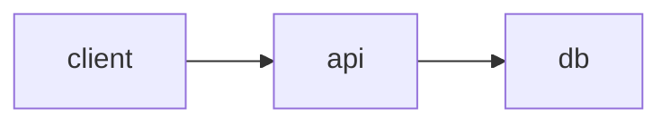

# Formatting for the user's app

The app renders plain markdown as native components. Use these where they help the reader,
and keep ordinary prose as prose. Everything here is standard markdown, so it reads fine
anywhere else too.

| Write | Shown as |
|---|---|
| A markdown table | A native table |
| `- [ ] step` / `- [x] step` | A checklist |
| A ```` ```mermaid ```` block | A diagram |
| A ```` ```chart ```` block of CSV | A chart |
| `> [!NOTE]`, `> [!TIP]`, `> [!IMPORTANT]`, `> [!WARNING]`, `> [!CAUTION]` | A callout |
| `src/main.rs:42` | A file link that opens the file |
| A PR, issue or commit URL | A card with its number or short SHA |

## Tables

Use them for comparisons and lists of records, not for prose. Put the thing being compared
in the first column. Keep cells short.

| Option | Speed | Cost |
|---|---|---|
| Redis | fast | $$ |
| SQLite | ok | free |

## Checklists

For steps in a plan or the state of work. `[x]` is done, `[ ]` is not.

- [x] Reproduce the bug
- [x] Add a failing test
- [ ] Fix the parser

## Diagrams

Mermaid flowcharts, sequence, state, class and ER diagrams. Keep labels short.



## Charts

A ```` ```chart ```` block holds CSV. The header row names the x column, then one column per
series. Optional `key: value` lines go first: `kind` (line, bar, area, point, pie), `title`,
`x`, `y` (axis labels), `stacked: true`. Without `kind`, text x values make a bar chart and
numbers make a line chart. A pie uses the first series.

```chart
kind: line
title: p95 latency (ms)
day,before,after
Mon,120,80
Tue,135,78
Wed,128,75
```

Use a chart when the shape of the numbers matters. When the exact values matter, use a table.

## Callouts

```markdown
> [!WARNING]
> This drops the production table.
```

Use them sparingly, for what the user must not miss.

## Links

- Files: `path:line` (`src/server.rs:118`), relative to the working directory or absolute.
- PRs, issues and commits: the full URL (`https://github.com/owner/repo/pull/128`), not
  just `#128`.
